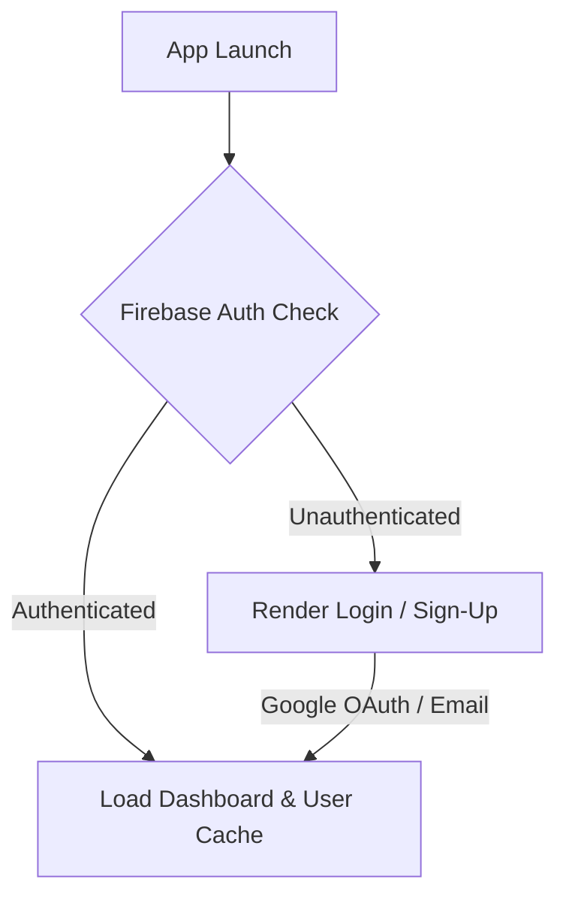
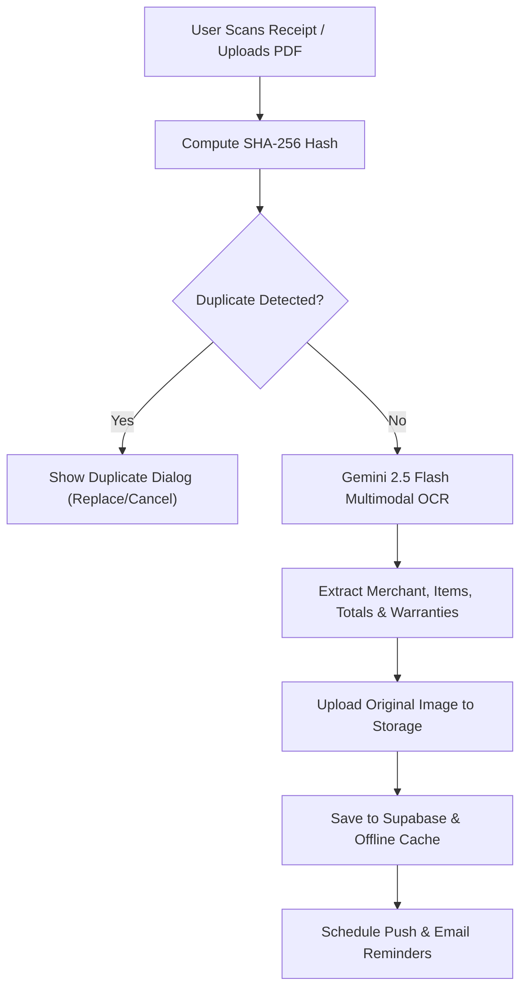
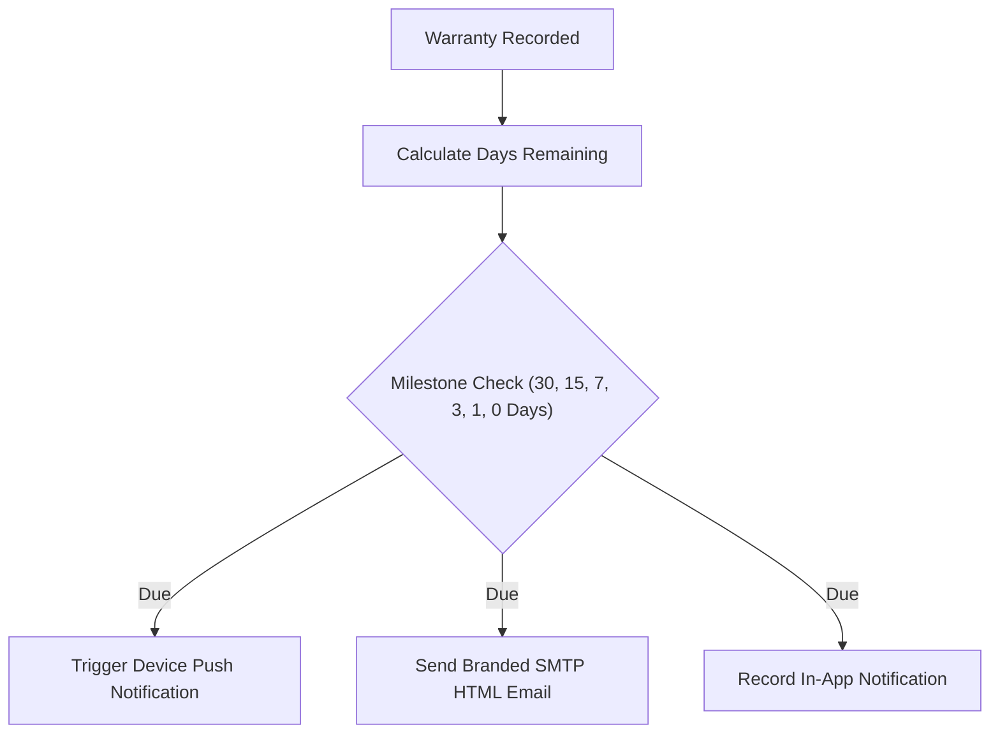

# Receipto 🧾 — AI-Powered Expense & Warranty Manager

[](https://flutter.dev)
[](https://dart.dev)
[](https://supabase.com)
[](https://firebase.google.com)
[](https://ai.google.dev)
[](https://riverpod.dev)
[](LICENSE)

**Receipto** is a production-grade, privacy-focused mobile application built with Flutter that revolutionizes how consumers and professionals digitize paper receipts, manage expenses, safeguard product warranties, and gain actionable financial insights using multimodal Artificial Intelligence.

---

## 📖 Introduction

### What is Receipto?
Receipto is an intelligent expense companion and warranty vault powered by **Google Gemini 2.5 Flash AI** and **Supabase Relational Backend Services**. By combining advanced multimodal optical character recognition (OCR), automated warranty period extraction, user-scoped offline caching, multi-format exports (PDF, CSV, JSON), interactive warranty calendars, duplicate prevention, and a Google Photos-style Recycle Bin, Receipto turns paper clutter into a secure, organized digital inventory.

### Why It Was Built
Physical thermal paper receipts fade, tear, and get lost. When appliances malfunction or warranty service claims are needed months or years later, consumers are left without proof of purchase. Meanwhile, manual expense tracking apps are tedious and time-consuming. Receipto was built to eliminate manual entry entirely: snap a photo or pick a document, and the AI extracts merchant details, timestamps, itemized products, totals, tax IDs, and warranty terms in seconds.

### Key Highlights
- ⚡ **Instant AI Extraction**: Multimodal OCR extracts metadata, line items, totals, and warranty terms in under 3 seconds.
- 📴 **Offline Receipt Access**: Complete user-scoped local caching of receipts, item details, warranties, and images with automatic background sync.
- 📅 **Interactive Warranty Calendar**: Visual monthly warranty calendar with active/expiring/expired status markers and date filtering.
- 📤 **Multi-Format Export**: Export single or consolidated receipts to PDF invoice reports, CSV spreadsheets, or JSON datasets with native share sheets.
- 🤖 **Conversational AI Assistant**: Ask natural language questions like *"Is my microwave still under warranty?"* or *"How much did I spend at Croma?"*.
- 🛡️ **Multi-Tier Duplicate Prevention**: SHA-256 fingerprint hashing and token matching prevent duplicate expense uploads.
- 🗑️ **Gallery-Style Recycle Bin**: Soft-delete receipts with a 30-day safety retention period and auto-purge worker.
- 🔔 **Multi-Channel Reminders**: Device push notifications and automated HTML emails delivered 30, 15, 7, 3, 1, and 0 days prior to warranty expiration.

---

## 📋 Table of Contents

1. [Project Features](#-project-features)
2. [Feature Matrix & Implementation Status](#-feature-matrix--implementation-status)
3. [Application Screenshots](#-application-screenshots)
4. [Tech Stack & Architecture](#-tech-stack--architecture)
5. [System Requirements](#-system-requirements)
6. [Flutter Installation & Setup](#-flutter-installation--setup)
7. [Android Phone & USB Debugging Setup](#-android-phone--usb-debugging-setup)
8. [Project Installation](#-project-installation)
9. [Firebase Authentication Setup](#-firebase-authentication-setup)
10. [Supabase Database & Storage Setup](#-supabase-database--storage-setup)
11. [Complete Supabase SQL Schema](#-complete-supabase-sql-schema)
12. [Google Gemini AI Setup](#-google-gemini-ai-setup)
13. [SMTP Email Reminders Setup](#-smtp-email-reminders-setup)
14. [Environment Configuration (.env)](#-environment-configuration-env)
15. [Application Workflow Diagrams](#-application-workflow-diagrams)
16. [Running & Testing the Project](#-running--testing-the-project)
17. [Building Production Release APK](#-building-production-release-apk)
18. [Troubleshooting & Common Fixes](#-troubleshooting--common-fixes)
19. [Security & Best Practices](#-security--best-practices)
20. [Future Roadmap](#-future-roadmap)
21. [License](#-license)

---

## ✨ Project Features

> [!NOTE]
> All features listed below are 100% implemented, tested, and active in the codebase.

### 🔐 1. Authentication & Security
- **Firebase Authentication**: Email/Password signup and login with email verification and secure session tokens.
- **Google Sign-In**: Native one-tap Google OAuth 2.0 single sign-on integration.
- **Biometric App Lock**: Optional biometric authentication (Fingerprint / Face ID) to protect financial data on app resume.
- **Reactive State Listener**: Clean auth state listener powered by Riverpod (`authStateChangesProvider`).

### 📷 2. AI Receipt Scanner & OCR
- **Multimodal AI OCR**: High-speed OCR powered by Google Gemini 2.5 Flash for camera photos and PDF uploads.
- **Field Extraction**: Automatic extraction of merchant name, invoice numbers, purchase timestamps, subtotal, tax amounts, discounts, and currency symbols (`₹`, `$`, `€`).
- **Pristine Quality Preservation**: Stores original uncompressed image scans for maximum readability during warranty claims.
- **Itemized Product Breakdown**: Line-item level parsing capturing item name, quantity, unit price, and total line price.
- **Smart Warranty Detection**: Automatic detection of electronics and appliances with automatic warranty duration extraction.

### 📴 3. Offline Access & Local Caching
- **User-Scoped Caching**: Storage is isolated by authenticated user UID (`user_<uid>_receipts`, `user_<uid>_warranties`).
- **Offline Data Available**: Complete receipt metadata, line items, warranties, and local receipt image files are cached in the device's application documents directory.
- **Transparent Fallback**: In offline or weak network conditions, the app seamlessly serves cached data without disruption.

### 📤 4. Multi-Format Receipt Export
- **PDF Reports**: Single-receipt digital tax invoices or consolidated multi-receipt summary reports complete with itemized tables and totals.
- **CSV Spreadsheets**: Structured tabular export compatible with Microsoft Excel, Google Sheets, and accounting software.
- **JSON Datasets**: Clean structured JSON files containing full receipt, product, and warranty parameters.
- **Native Share Integration**: Seamlessly share exported files via WhatsApp, Gmail, Drive, AirDrop, or Bluetooth using native OS share sheets (`share_plus`).

### 📅 5. Interactive Warranty Calendar
- **Monthly Grid View**: Interactive calendar view displaying all warranty expiration dates across the month.
- **Status Dot Markers**: Color-coded indicators on calendar days:
  - 🟢 **Active Warranty**
  - 🟡 **Expiring Soon** (within 30 days)
  - 🔴 **Expired Warranty**
- **Date Filtering & Navigation**: Tap any day to inspect products expiring on that date and tap to open the full warranty details screen.

### 💬 6. AI Warranty Assistant
- **Conversational Chat**: Interactive natural language assistant (`AIAssistantScreen`) with suggested quick prompts.
- **Context-Aware Query Engine**: Ask questions like *"Is my smartphone covered?"*, *"Show all purchases above ₹10,000"*, or *"How much did I spend on Groceries this month?"*.
- **Direct Navigation**: AI responses include tappable links and metadata cards directing users straight to the relevant receipt or warranty.

### 📊 7. Professional Analytics Dashboard
- **Monthly Spending Breakdown**: Tracks total monthly spending, average transaction sizes, and discount savings.
- **Category Distribution**: Dynamic visual pie chart depicting proportional spending across categories.
- **Interactive Weekly Activity**: Tap-to-inspect bar chart showing daily spending patterns and itemized transactions.
- **Merchant Insights**: Aggregated spending by merchant with transaction frequency counts.
- **Budget & Forecasting**: Set a custom monthly budget limit with spending velocity forecasts and visual budget health meters.
- **AI Spending Insights**: Automated contextual tips highlighting top expense drivers and savings opportunities.

### 🔔 8. Multi-Channel Reminder Engine
- **Local Push Notifications**: Scheduled device alerts at 30, 15, 7, 3, 1, and 0 days prior to warranty expiration (`flutter_local_notifications`).
- **Automated HTML Emails**: Background SMTP email worker sending clean branded reminder emails directly to the user's inbox.
- **In-App Notification Center**: View, filter (Unread, Warranty, Email, System), and manage all historical alerts with local persistence.

### 🛡️ 9. Priority Duplicate Detection
- **Tier 1**: SHA-256 cryptographic fingerprint hash comparison (`merchant_name + invoice_number + date + total`).
- **Tier 2**: Exact 4-field database record matching.
- **Tier 3**: Fallback token matching: filename + file size + Jaccard OCR token similarity (>80%).
- **User Choice**: Choose between replacing the existing record or cancelling the new upload.

### 🗑️ 10. Gallery-Style Recycle Bin
- **Soft-Delete System**: Marks receipts with `is_deleted = true` and records `deleted_at`.
- **30-Day Safety Window**: Soft-deleted receipts remain securely preserved for 30 days.
- **Actions**: Restore individual receipts, delete forever, or empty the entire recycle bin.
- **Automated Purge**: Background worker automatically removes records older than 30 days.

### 🎨 11. Dark Glassmorphism Design System
- **Theme Tokens**: Custom dark palette (`AppColors`), frosted glass cards (`GlassCard`), radial nebula gradients, and smooth 250ms micro-animations.

---

## ✅ Feature Matrix & Implementation Status

| Feature Module | Status | Technical Details |
| :--- | :---: | :--- |
| **AI Multimodal OCR** | ✅ Complete | Google Gemini 2.5 Flash for camera scans & PDFs |
| **AI Receipt Categorization** | ✅ Complete | AI category classifier with 25+ local keyword fallbacks |
| **Offline Receipt Vault** | ✅ Complete | User-scoped local storage (`SharedPreferences` & local files) |
| **Multi-Format Export** | ✅ Complete | PDF invoice summaries, CSV spreadsheets, structured JSON |
| **Interactive Warranty Calendar** | ✅ Complete | Monthly grid with color-coded status badges & day filters |
| **AI Warranty Assistant** | ✅ Complete | Conversational LLM with receipt & warranty query engine |
| **Financial Analytics** | ✅ Complete | Monthly spending, weekly bar charts, budget velocity forecasting |
| **Duplicate Prevention** | ✅ Complete | 3-tier SHA-256 fingerprint & Jaccard token comparison |
| **30-Day Recycle Bin** | ✅ Complete | Soft-delete retention with automatic 30-day purge worker |
| **Push Notifications** | ✅ Complete | Scheduled alerts at 30, 15, 7, 3, 1, 0 days via Local Notifications |
| **SMTP Email Alerts** | ✅ Complete | Automated HTML email delivery via `mailer` SMTP worker |
| **Biometric Security** | ✅ Complete | Fingerprint & Face ID local authentication lock wrapper |

---

## 🖼️ Application Screenshots

| Login & Authentication | Overview Dashboard |
| :---: | :---: |
|  |  |

| Financial Analytics | AI Warranty Assistant |
| :---: | :---: |
|  |  |

| Receipts & Details | Warranty Calendar & Tracker |
| :---: | :---: |
|  |  |

---

## 🛠️ Tech Stack & Architecture

```
RECEIPTO/
├── android/                         # Android native workspace & Gradle configuration
├── assets/                          # App iconography, fonts, and animation assets
├── ios/                             # iOS Xcode workspace
│
├── lib/
│   ├── main.dart                    # App bootstrap & service initializers
│   ├── firebase_options.dart        # Firebase credentials configuration
│   │
│   ├── app/                         # App layer configuration
│   │   ├── app.dart                 # Root MaterialApp widget & global providers
│   │   └── config/
│   │       ├── routes.dart          # GoRouter route hierarchy & page transitions
│   │       └── theme.dart           # Design tokens, typography & color themes
│   │
│   ├── core/                        # Shared cross-cutting modules
│   │   ├── constants/               # Global design tokens (AppColors, AppSpacing, etc.)
│   │   ├── services/                # Core domain services:
│   │   │   ├── firebase_auth_service.dart
│   │   │   ├── receipt_database_service.dart
│   │   │   ├── warranty_database_service.dart
│   │   │   ├── notification_database_service.dart
│   │   │   ├── offline_cache_service.dart
│   │   │   ├── receipt_export_service.dart
│   │   │   ├── reminder_engine.dart
│   │   │   ├── storage_service.dart
│   │   │   └── ...
│   │   ├── utils/                   # CurrencyFormatter, WarrantyUtils, Date parsers
│   │   └── widgets/                 # Reusable UI components (GlassCard, ShellLayout, etc.)
│   │
│   └── features/                    # Feature-First Business Modules
│       ├── ai_assistant/            # Smart Warranty Assistant (Chat interface & AI agent)
│       ├── analytics/               # Financial Analytics & Spending Breakdown
│       ├── auth/                    # Authentication (Login, Sign-Up, Splash, App Lock)
│       ├── dashboard/               # Overview Dashboard & Quick Action Cards
│       ├── notifications/           # In-App Notification Center & Alert Preferences
│       ├── profile/                 # User Settings, Recycle Bin & Account Management
│       ├── receipts/                # Receipt Inventory, Details & Export Workflows
│       ├── scan/                    # Receipt Capture, OCR Extraction & Product Analysis
│       └── warranty/                # Warranty Tracker & Interactive Warranty Calendar
│
├── pubspec.yaml                     # Dependencies & asset declarations
└── README.md                        # Documentation
```

### Core Dependencies
```yaml
dependencies:
  flutter:
    sdk: flutter
  flutter_riverpod: ^2.5.1
  go_router: ^14.2.7
  google_fonts: ^6.2.1
  firebase_core: ^4.11.0
  firebase_auth: ^6.5.4
  google_sign_in: ^7.2.0
  supabase_flutter: ^2.15.2
  flutter_dotenv: ^6.0.1
  image_picker: ^1.2.2
  file_picker: ^8.0.0
  path_provider: ^2.1.3
  pdf: ^3.12.0
  printing: ^5.14.3
  share_plus: ^12.0.2
  open_filex: ^4.7.0
  flutter_local_notifications: ^20.1.0
  mailer: ^7.1.0
  local_auth: ^3.0.1
  crypto: ^3.0.7
  shared_preferences: ^2.5.2
  shimmer: ^3.0.0
```

---

## 💻 System Requirements

- **Operating System**: Windows 10/11, macOS (12+), or Linux (Ubuntu 22.04+)
- **Flutter SDK**: Version 3.29.0 or higher
- **Dart SDK**: Version 3.7.0 or higher
- **JDK / Java**: OpenJDK 17 or Version 21
- **Android Studio**: Ladybug (2024.2+) or Android Build Tools `34.0.0`
- **Android Device**: Physical device or Emulator running Android 8.0+ (API Level 26+)
- **Git**: Version 2.40+

---

## ⚙️ Flutter Installation & Setup

### 1. Install Flutter SDK
1. Download the Flutter SDK stable archive from [flutter.dev/docs/get-started/install](https://docs.flutter.dev/get-started/install).
2. Extract the archive to your preferred directory (e.g., `C:\src\flutter` on Windows or `~/development/flutter` on macOS).

### 2. Configure System Environment PATH
- **Windows**: Search for *Environment Variables* -> Edit Path -> Add `C:\src\flutter\bin`.
- **macOS/Linux**: Add to `~/.zshrc` or `~/.bashrc`:
  ```bash
  export PATH="$HOME/development/flutter/bin:$PATH"
  ```
- Verify Flutter installation:
  ```bash
  flutter --version
  ```

### 3. Run Flutter Doctor & Accept Licenses
```bash
flutter doctor
flutter doctor --android-licenses
```
*(Press `y` to accept all licenses).*

---

## 📱 Android Phone & USB Debugging Setup

### 1. Enable Developer Options
1. Open **Settings** on your Android phone.
2. Navigate to **About Phone** -> Locate **Build Number**.
3. Tap **Build Number** 7 times until you see `"You are now a developer!"`.

### 2. Enable USB Debugging
1. Go to **Settings** -> **System** -> **Developer Options**.
2. Toggle **USB Debugging** to `ON`.

### 3. Connect & Authorize
1. Connect your phone to your PC via a USB cable.
2. When prompted on your phone, check **"Always allow from this computer"** and tap **Allow**.
3. Verify connection:
   ```bash
   flutter devices
   ```

---

## 🚀 Project Installation

### 1. Clone Repository
```bash
git clone https://github.com/milanraj-github/RECEIPTO.git
cd RECEIPTO
```

### 2. Fetch Dependencies
```bash
flutter clean
flutter pub get
```

### 3. Create Environment File
Create a `.env` file in the root directory of the project:
```bash
touch .env
```
*(Populate `.env` with keys as described in the [Environment Configuration](#-environment-configuration-env) section).*

---

## 🔥 Firebase Authentication Setup

1. Create a project in the [Firebase Console](https://console.firebase.google.com/).
2. Click **Add App** -> Select **Android**.
3. Register your package name (e.g., `com.receipto.receipto`).
4. Generate your SHA-1 key:
   ```bash
   cd android
   ./gradlew signingReport
   ```
5. Paste the SHA-1 fingerprint into your Firebase App settings.
6. Download `google-services.json` and place it in `android/app/google-services.json`.
7. Enable **Email/Password** and **Google Sign-In** under **Authentication -> Sign-in method**.

---

## ⚡ Supabase Database & Storage Setup

1. Create a free project at [supabase.com](https://supabase.com).
2. Go to **Project Settings -> API**:
   - Copy **Project URL** (`SUPABASE_URL`).
   - Copy **anon public key** (`SUPABASE_ANON_KEY`).
3. Go to **Storage**:
   - Create a public bucket named `receipts`.
   - Ensure public access is enabled so receipt images load reliably over HTTPS.

---

## 🗄️ Complete Supabase SQL Schema

> [!IMPORTANT]
> Paste the SQL below into your **Supabase Dashboard -> SQL Editor** and click **Run**.

```sql
-- =========================================================
-- RECEIPTO COMPLETE DATABASE SCHEMA
-- =========================================================

-- 1. PROFILES TABLE
CREATE TABLE IF NOT EXISTS public.profiles (
    id UUID PRIMARY KEY REFERENCES auth.users(id) ON DELETE CASCADE,
    email TEXT,
    full_name TEXT,
    avatar_url TEXT,
    created_at TIMESTAMPTZ DEFAULT NOW()
);

-- 2. RECEIPTS TABLE
CREATE TABLE IF NOT EXISTS public.receipts (
    id BIGINT GENERATED ALWAYS AS IDENTITY PRIMARY KEY,
    user_id TEXT NOT NULL,
    merchant_name TEXT,
    date TEXT,
    time TEXT,
    receipt_number TEXT,
    invoice_number TEXT,
    receipt_hash TEXT NULL,
    file_size BIGINT NULL,
    confidence_score DOUBLE PRECISION NULL,
    gst_number TEXT,
    payment_method TEXT,
    currency TEXT DEFAULT '₹',
    grand_total DOUBLE PRECISION,
    total DOUBLE PRECISION,
    tax DOUBLE PRECISION,
    discount DOUBLE PRECISION,
    subtotal DOUBLE PRECISION,
    category TEXT,
    image_url TEXT,
    merchant_address TEXT,
    merchant_phone TEXT,
    original_file_name TEXT,
    raw_text TEXT,
    is_deleted BOOLEAN DEFAULT FALSE,
    deleted_at TIMESTAMPTZ NULL,
    created_at TIMESTAMPTZ DEFAULT NOW()
);

-- 3. RECEIPT ITEMS TABLE
CREATE TABLE IF NOT EXISTS public.receipt_items (
    id BIGINT GENERATED ALWAYS AS IDENTITY PRIMARY KEY,
    receipt_id BIGINT REFERENCES public.receipts(id) ON DELETE CASCADE,
    name TEXT NOT NULL,
    quantity DOUBLE PRECISION DEFAULT 1,
    unit_price DOUBLE PRECISION DEFAULT 0,
    total_price DOUBLE PRECISION DEFAULT 0,
    warranty_available BOOLEAN DEFAULT FALSE,
    warranty_period INT NULL,
    warranty_unit TEXT NULL,
    created_at TIMESTAMPTZ DEFAULT NOW()
);

-- 4. WARRANTIES TABLE
CREATE TABLE IF NOT EXISTS public.warranties (
    id BIGINT GENERATED ALWAYS AS IDENTITY PRIMARY KEY,
    user_id TEXT NOT NULL,
    receipt_id BIGINT REFERENCES public.receipts(id) ON DELETE CASCADE,
    product_name TEXT NOT NULL,
    merchant_name TEXT NOT NULL,
    invoice_number TEXT NULL,
    purchase_date TEXT NOT NULL,
    warranty_period INT NOT NULL,
    warranty_unit TEXT NOT NULL,
    expiry_date TEXT NOT NULL,
    image_url TEXT NULL,
    status TEXT DEFAULT 'ACTIVE',
    brand TEXT NULL,
    model TEXT NULL,
    serial_number TEXT NULL,
    notification_30_sent BOOLEAN DEFAULT FALSE,
    notification_15_sent BOOLEAN DEFAULT FALSE,
    notification_7_sent BOOLEAN DEFAULT FALSE,
    notification_3_sent BOOLEAN DEFAULT FALSE,
    notification_1_sent BOOLEAN DEFAULT FALSE,
    notification_today_sent BOOLEAN DEFAULT FALSE,
    notification_expired_sent BOOLEAN DEFAULT FALSE,
    email_30_sent BOOLEAN DEFAULT FALSE,
    email_15_sent BOOLEAN DEFAULT FALSE,
    email_7_sent BOOLEAN DEFAULT FALSE,
    email_3_sent BOOLEAN DEFAULT FALSE,
    email_1_sent BOOLEAN DEFAULT FALSE,
    email_today_sent BOOLEAN DEFAULT FALSE,
    email_expired_sent BOOLEAN DEFAULT FALSE,
    created_at TIMESTAMPTZ DEFAULT NOW()
);

-- 5. NOTIFICATIONS TABLE
CREATE TABLE IF NOT EXISTS public.notifications (
    id BIGINT GENERATED ALWAYS AS IDENTITY PRIMARY KEY,
    user_id TEXT NOT NULL,
    warranty_id BIGINT NULL,
    receipt_id BIGINT NULL,
    title TEXT NOT NULL,
    message TEXT NOT NULL,
    type TEXT DEFAULT 'SYSTEM',
    is_read BOOLEAN DEFAULT FALSE,
    created_at TIMESTAMPTZ DEFAULT NOW()
);

-- =========================================================
-- INDEXES FOR OPTIMAL QUERY PERFORMANCE
-- =========================================================
CREATE INDEX IF NOT EXISTS idx_receipts_user_id ON public.receipts(user_id);
CREATE INDEX IF NOT EXISTS idx_receipts_hash ON public.receipts(receipt_hash);
CREATE INDEX IF NOT EXISTS idx_receipts_deleted ON public.receipts(is_deleted);
CREATE INDEX IF NOT EXISTS idx_receipt_items_receipt_id ON public.receipt_items(receipt_id);
CREATE INDEX IF NOT EXISTS idx_warranties_user_id ON public.warranties(user_id);
CREATE INDEX IF NOT EXISTS idx_warranties_receipt_id ON public.warranties(receipt_id);
CREATE INDEX IF NOT EXISTS idx_notifications_user_id ON public.notifications(user_id);

-- Enable Row Level Security (RLS)
ALTER TABLE public.receipts ENABLE ROW LEVEL SECURITY;
ALTER TABLE public.receipt_items ENABLE ROW LEVEL SECURITY;
ALTER TABLE public.warranties ENABLE ROW LEVEL SECURITY;
ALTER TABLE public.notifications ENABLE ROW LEVEL SECURITY;

-- Allow Public Access Policies
CREATE POLICY "Public Read/Write Receipts" ON public.receipts FOR ALL USING (true) WITH CHECK (true);
CREATE POLICY "Public Read/Write Receipt Items" ON public.receipt_items FOR ALL USING (true) WITH CHECK (true);
CREATE POLICY "Public Read/Write Warranties" ON public.warranties FOR ALL USING (true) WITH CHECK (true);
CREATE POLICY "Public Read/Write Notifications" ON public.notifications FOR ALL USING (true) WITH CHECK (true);
```

---

## 🤖 Google Gemini AI Setup

1. Visit [Google AI Studio](https://aistudio.google.com/).
2. Click **Create API Key**.
3. Copy your API key into your `.env` file under `GEMINI_API_KEY`.

---

## 📧 SMTP Email Reminders Setup

1. Open your Google Account -> **Security**.
2. Enable **2-Step Verification**.
3. Under **App passwords**, create an app password named `Receipto`.
4. Copy the generated 16-character password into your `.env` under `SMTP_PASSWORD`.

---

## 🔑 Environment Configuration (.env)

Create `.env` in the root of your project:

```env
# SUPABASE BACKEND CONFIGURATION
SUPABASE_URL=https://your-project.supabase.co
SUPABASE_ANON_KEY=your-supabase-anon-key

# GOOGLE AI GEMINI CONFIGURATION
GEMINI_API_KEY=your-gemini-api-key

# SMTP EMAIL REMINDER CONFIGURATION
SMTP_HOST=smtp.gmail.com
SMTP_PORT=587
SMTP_USERNAME=your-email@gmail.com
SMTP_PASSWORD=your-16-char-app-password
SMTP_SENDER=your-email@gmail.com
```

---

## 🔄 Application Workflow Diagrams

### 1. Authentication & Session Flow


### 2. Receipt Scan & AI Extraction Flow


### 3. Warranty Expiration & Reminder Flow


---

## 🧪 Running & Testing the Project

```bash
# Clean build artifacts
flutter clean

# Get packages
flutter pub get

# Run on connected device
flutter run

# Verify zero static analysis errors
flutter analyze

# Execute test suite
flutter test
```

---

## 📦 Building Production Release APK

```bash
flutter clean
flutter pub get
flutter build apk --release
```
The compiled release APK will be located at:
`build/app/outputs/flutter-apk/app-release.apk`

---

## 🛠️ Troubleshooting & Common Fixes

### 1. `PostgrestException: invalid input syntax for type integer`
- **Cause**: Querying an integer-typed column with a string Firebase Auth UID.
- **Fix**: The app automatically uses local resilient fallback and queries string IDs safely. Ensure database columns are typed as `TEXT`.

### 2. `type 'Null' is not a subtype of type 'OfflineCacheService'`
- **Cause**: Hot reload encountering uninstantiated non-nullable service fields in memory.
- **Fix**: Resolved with `OfflineCacheService.instance` singleton fallback across database providers.

### 3. `Gemini API Quota Exceeded (HTTP 429)`
- **Cause**: Free tier Google AI Studio rate limit reached.
- **Fix**: Generate a new API key from [Google AI Studio](https://aistudio.google.com) and update `GEMINI_API_KEY` in `.env`.

### 4. `USB Device Not Detected`
- **Cause**: ADB connection refused or charge-only USB cable.
- **Fix**: Switch to a high-quality data cable, toggle USB Debugging, and restart ADB:
  ```bash
  adb kill-server && adb start-server
  ```

---

## 🔒 Security & Best Practices

1. **API Keys**: Never commit `.env` or `google-services.json` to version control.
2. **User Isolation**: All receipt queries and cache entries are strictly scoped by Firebase UID (`user_id`).
3. **Data Integrity**: Soft-deleted receipts are preserved for 30 days before permanent deletion.
4. **Code Health**: Maintain zero compiler warnings via `flutter analyze`.

---

## 🚀 Future Roadmap

- ⏳ **AI Financial Health Score**: Long-term financial stability scoring based on multi-month spending patterns.
- ⏳ **Product Price Tracking**: Automated price drop alerts for items purchased at supported merchants.
- ⏳ **Manufacturer Safety Recalls**: Automatic recall checks matching scanned product serial numbers.
- ⏳ **Automated Warranty Claim Wizard**: AI-generated formal claim letters and email drafts for repair centers.

---

## 📄 License

This project is licensed under the MIT License — see the [LICENSE](LICENSE) file for details.
